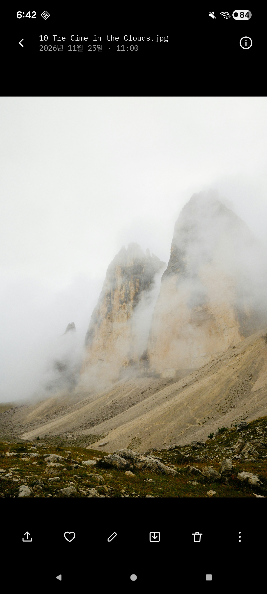

# CloudiPix

CloudiPix는 **WebDAV·FTP 폴더를 갤러리 앨범으로 연결하는 Android 앱**입니다. 서버에 있는 사진을 앨범에서 바로 열고, 원하는 폴더는 기기와 동기화할 수 있습니다.

[APK 다운로드](https://github.com/loopix8000/CloudiPix/releases/latest) · Android 11 이상

## 클라우드 앨범과 동기화

| 갤러리 폴더 목록 | 원격 사진 뷰어 | 폴더 동기화 설정 |
| :---: | :---: | :---: |
|  |  |  |

- 연결한 폴더의 사진을 갤러리에서 탐색하고 뷰어에서 서버 원본을 엽니다.
- 폴더별로 양방향 동기화를 켜고 기기 저장 위치를 정할 수 있습니다. 동기화 기록에서 업로드, 다운로드, 삭제 결과를 확인합니다.

## 빌드

Windows에서 JDK 21과 Android SDK 36, Build Tools 35.0.0을 준비한 뒤 프로젝트 디렉터리에서 실행합니다.

```powershell
.\gradlew.bat :app:assembleDebug
```

APK는 `app/build/outputs/apk/debug/app-debug.apk`에 생성됩니다.

## 사진 편집

뷰어의 편집 버튼으로 CloudiPix 사진 편집기를 엽니다. 자르기, 회전, 반전, 밝기·노출·대비·채도·색온도 조정과 미리보기가 있는 필터를 제공합니다. 사진 위에 선을 그리거나 텍스트를 추가하고 옮길 수 있습니다. 저장하면 기기 또는 원래 서버 폴더에 편집본이 추가됩니다. 필터와 색 보정은 [ImageToolboxLibs](https://github.com/T8RIN/ImageToolboxLibs)의 GPUImage를 사용합니다.

## 출처

재사용한 Simplify my Gallery 소스에는 [MPL 2.0](LICENSE)을 적용합니다. 글꼴 고지는 [licenses](licenses/)에, Lucide 고지는 [앱 자산](app/src/main/assets/licenses/Lucide-ISC.txt)에 있습니다.
