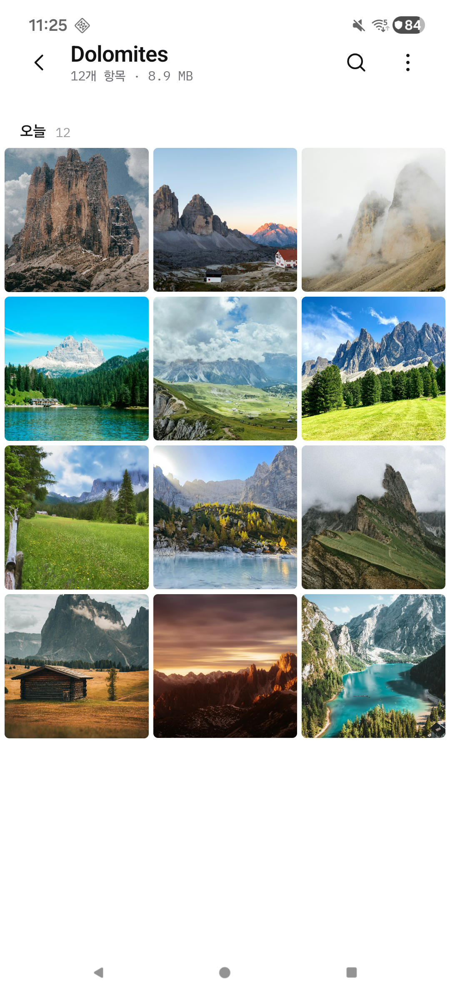
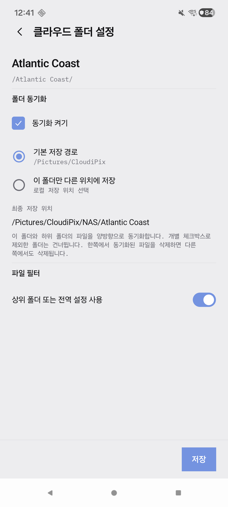
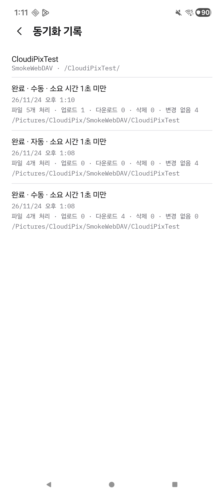

<p align="center">
  
</p>

<h1 align="center">CloudiPix</h1>

<p align="center"><b>NAS와 클라우드의 사진 폴더를 휴대폰 앨범처럼 보는 Android 갤러리</b></p>

<p align="center">
  <a href="https://github.com/loopix8000/CloudiPix/releases/latest">APK 다운로드</a> · Android 11 이상
</p>

WebDAV나 FTP 서버의 사진 폴더를 연결하면, 휴대폰에 있는 폴더와 같은 목록에 앨범으로 나타납니다. 사진을 미리 내려받거나 동기화하지 않아도 휴대폰 사진처럼 바로 넘겨 보고 크게 열 수 있습니다.

## 클라우드 앨범

| 갤러리 폴더 목록 | 서버 사진 보기 |
| :---: | :---: |
|  |  |

- **휴대폰 폴더와 같은 목록:** 연결한 서버 폴더가 휴대폰 폴더 사이에 앨범으로 함께 보입니다. 구름 아이콘으로 서버 앨범을 구분합니다.
- **내려받지 않고 바로 보기:** 앨범을 열면 썸네일을 바로 넘겨 보고, 사진을 누르면 서버의 원본을 엽니다.
- **연결이 끊겨도 목록 유지:** 한 번 불러온 앨범은 서버에 연결되지 않을 때도 목록과 썸네일을 그대로 보여 줍니다. 원본은 서버에 다시 연결되면 열 수 있습니다.
- **휴대폰과 서버 사이 정리:** 휴대폰 사진을 서버 폴더로 복사하거나 옮기고, 서버 사진을 휴대폰 폴더로 가져올 수 있습니다.
- **캐시 용량 관리:** 본 사진은 캐시에 저장해 다시 열 때 빠릅니다. 캐시 한도를 정하거나 비울 수 있습니다.

## 폴더 동기화

| 동기화 설정 | 동기화 기록 |
| :---: | :---: |
|  | <a href="screenshots/folder-sync-history.png"></a> |

휴대폰에도 항상 두고 싶은 폴더는 동기화를 켭니다. 폴더마다 휴대폰의 저장 위치를 정하고, 양쪽의 추가·수정·삭제를 서로 맞춥니다. 동기화 기록에서 업로드, 다운로드, 삭제 결과를 확인할 수 있습니다.

## 사진 편집

사진 보기 화면의 편집 버튼으로 편집기를 엽니다. 자르기, 회전, 반전, 밝기·노출·대비·채도·색온도 조정, 미리보기가 있는 필터, 그리기와 텍스트 넣기를 지원합니다. 저장하면 편집본이 원래 사진이 있던 폴더(휴대폰 또는 서버)에 추가됩니다.

## 개인정보

광고가 없고, 사용 데이터와 오류 보고서를 수집하지 않습니다. 앱이 연결하는 곳은 사용자가 등록한 서버와 새 버전 확인을 위한 GitHub 릴리스뿐입니다.

## 빌드

Windows에서 JDK 21과 Android SDK 36, Build Tools 35.0.0을 준비한 뒤 프로젝트 디렉터리에서 실행합니다.

```powershell
.\gradlew.bat :app:assembleDebug
```

APK는 `app/build/outputs/apk/debug/app-debug.apk`에 생성됩니다.

## 오픈 소스 라이선스

앱의 **설정 → 앱 정보**에 있는 목록과 같습니다.

| 이름 | 라이선스 |
| --- | --- |
| [Simplify my Gallery](https://github.com/simplifymy-app/gallery) | Mozilla Public License 2.0 |
| [AndroidX, Jetpack Compose, Room, Media3](https://developer.android.com/jetpack/androidx) | Apache License 2.0 |
| [Hilt](https://dagger.dev/hilt/) | Apache License 2.0 |
| [Coil](https://coil-kt.github.io/coil/) | Apache License 2.0 |
| [Telephoto](https://github.com/saket/telephoto) | Apache License 2.0 |
| [OkHttp](https://square.github.io/okhttp/) | Apache License 2.0 |
| [Apache Commons Net](https://commons.apache.org/proper/commons-net/) | Apache License 2.0 |
| [Lucide](https://lucide.dev/license) | ISC License / Feather MIT License |
| [ImageToolboxLibs (GPUImage)](https://github.com/T8RIN/ImageToolboxLibs/tree/8.4.1/libs/gpuimage) | Apache License 2.0 |
| [Cropper, Gesture (Image Toolbox)](https://github.com/T8RIN/ImageToolbox/tree/8fbf8bc335758465107278772b54e33070cf0fa2/lib) | Apache License 2.0 |
| [Caveat, IBM Plex, Outfit, Space Grotesk](https://openfontlicense.org/) | SIL Open Font License 1.1 |

Simplify my Gallery에서 가져와 고친 소스 파일에는 [MPL 2.0](LICENSE)이 적용됩니다. 글꼴 라이선스 전문은 [licenses](licenses/) 폴더에, Lucide 라이선스 전문은 [licenses/Lucide-ISC.txt](licenses/Lucide-ISC.txt)에 있습니다.
